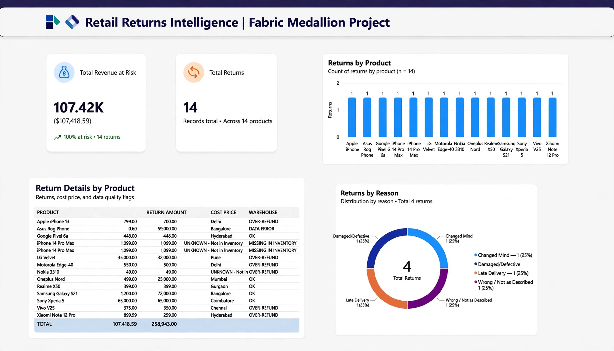

# Retail Returns Intelligence | Microsoft Fabric Medallion

🚀 End-to-End Data Engineering Project - From Raw Data to Business Insights

## 📊 Dashboard Preview

**Key Metrics:** $107.4K Revenue at Risk | 14 Returns Flagged

## 🏗️ Architecture - Medallion Pattern

**Bronze Layer:** OneLake - Raw CSV ingestion via Fabric Pipeline
**Silver Layer:** PySpark Notebook - Cleaning + Data Quality Flags
- OVER-REFUND: return_amount > cost_price
- DATA ERROR: cost = 0 
- MISSING INVENTORY: warehouse = UNKNOWN
**Gold Layer:** Dimensional Model (gold_kpis, gold_returns_by_product) + Direct Lake + Power BI

## 📁 Repo Contents
- `Return_Report.jpg` - Power BI Dashboard
- `return_analysis_report.png` - Workspace Proof

## 🛠️ Tech Stack
Microsoft Fabric | OneLake Lakehouse | PySpark | Pipeline | Direct Lake | Power BI

## 💡 Key Insight Found
Flagged LG Velvet over-refund (35K refund vs 32K cost) & Asus Rog data errors using Silver layer logic.

Built by Sankarmathi
#MicrosoftFabric #DataEngineering #Medallion #PowerBI
